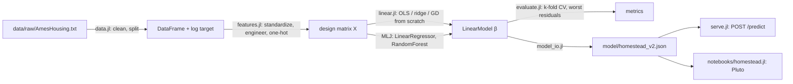

# Homestead: House Price Prediction in Julia

Predicts sale prices for houses in Ames, Iowa, from 80 features. Built to
practice the full loop, not just `fit()`:

**Problem → Data → Baseline → Model → Evaluation → Improvement → Deployment**

The linear models (OLS via the normal equation, ridge, and gradient descent)
are written from scratch in `src/linear.jl` and checked against MLJ. They agree
to 1e-14. Cross-validation is written from scratch too. The tree model uses MLJ.

## Results

RMSE on log(price): 0.10 means predictions are typically off by about 10%.

| Step | Model | RMSE (log) | ≈ error |
|---|---|---|---|
| Baseline | Predict the training median ($160k) for everything | 0.4326 | ±54% |
| Baseline | Straight line on living area | 0.2895 | ±34% |
| Model | OLS, 33 numeric features (normal equation, from scratch) | 0.1317 (5-fold CV) | ±14% |
| Improvement | + 6 engineered features | 0.1284 (CV) | ±14% |
| Improvement | + one-hot of 15 categoricals, ridge λ=30 (115 columns) | 0.1176 (CV) | ±12% |
| Improvement | Random forest, 300 trees (MLJ) | 0.1301 (val) | ±14% |
| **Final** | **Ridge λ=30, fit on train+val, scored on the held-out test set once** | **0.1097** | **±11.6%, R² 0.924, MAE $13.8k** |

### What I learned

- **Collinearity breaks the normal equation.** `Gr Liv Area` is exactly
  `1st Flr SF + 2nd Flr SF + Low Qual Fin SF`. Keep both and XᵀX is singular,
  `inv` fails. Dropped the totals, kept the parts. Engineered features were
  then chosen to be non-linear (logs, squares, a product) for the same reason.
- **One validation split lies a little.** OLS scored 0.1250 on the split and
  0.1317 ± 0.006 under 5-fold CV. The split was lucky.
- **Error analysis beat guessing.** The worst misses were cheap pre-1970 houses
  in IDOTRR, OldTown and BrkSide, overpredicted by 40–75%. Neighborhood is a
  string column the numeric matrix never saw. One-hot encoding it was the
  biggest single improvement.
- **Regularization did almost nothing** with 33 features on 2,000 rows
  (λ sweep flat from 0 to 30). It mattered a bit once there were 115 columns.
- **The random forest lost to ridge.** With a log target, Ames is close to
  additive. Trees spent their capacity on noise. Kept the result as-is.
- **Some houses are the noise floor.** A $40k house from 1920 and two
  "Alloca" (allocation, non-market) sales top the miss list in every version.

## Architecture



## Run

```sh
julia --project=. -e 'using Pkg; Pkg.instantiate()'
julia --project=. test/runtests.jl            # 31 unit tests
julia --project=. scripts/01_baseline.jl      # steps 3–7 in order
julia --project=. scripts/02_linear.jl
julia --project=. scripts/03_evaluate.jl
julia --project=. scripts/04_improve.jl
julia --project=. scripts/05_train_final.jl   # writes model/homestead_v2.json, scores test set
julia --project=. test/test_serve.jl          # integration test of the endpoint
```

### API

```sh
julia --project=. src/serve.jl                # http://127.0.0.1:8080
curl -X POST localhost:8080/predict -H 'Content-Type: application/json' \
  -d '{"Gr Liv Area": 1500, "Overall Qual": 7, "Year Built": 2005, "Neighborhood": "CollgCr"}'
# → {"price":179971,"log_price":12.1006}
```

Any Ames column may be sent. Missing ones take the training median or mode.

### Notebook

```julia
using Pluto; Pluto.run()     # open notebooks/homestead.jl
```

## Layout

```
src/data.jl        load, clean, split
src/metrics.jl     rmse, mae, r2
src/baseline.jl    median and one-feature baselines
src/features.jl    v1 numeric matrix, v2 engineered + one-hot
src/linear.jl      OLS (normal equation + QR), ridge, gradient descent
src/evaluate.jl    k-fold CV, worst residuals
src/model_io.jl    save/load JSON, predict from raw fields
src/serve.jl       HTTP.jl endpoint
scripts/           one script per step of the loop
test/              unit tests + endpoint integration test
```

## Data

De Cock, D. (2011). *Ames, Iowa: Alternative to the Boston Housing Data as an
End of Semester Regression Project.* Journal of Statistics Education 19(3).
The raw file is not committed; `data/raw/AmesHousing.txt` comes from
<http://jse.amstat.org/v19n3/decock/AmesHousing.txt>.
