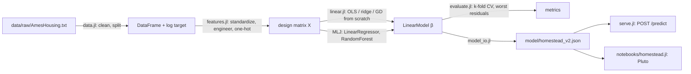

# Homestead: House Price Prediction in Julia

Predicts sale prices for houses in Ames, Iowa, from 80 features. Built to
practice the full loop, not just `fit()`:

**Problem → Data → Baseline → Model → Evaluation → Improvement → Deployment**

The linear models (OLS via the normal equation, ridge, and gradient descent)
are written from scratch in `src/linear.jl` and checked against MLJ. They agree
to 1e-14. Cross-validation is written from scratch too. The tree model uses MLJ.

## Results

RMSE on log(price): 0.10 means predictions are typically off by about 10%.

| Step | Model | RMSE (log) | ≈ error |
|---|---|---|---|
| Baseline | Predict the training median ($160k) for everything | 0.4326 | ±54% |
| Baseline | Straight line on living area | 0.2895 | ±34% |
| Model | OLS, 33 numeric features (normal equation, from scratch) | 0.1317 (5-fold CV) | ±14% |
| Improvement | + 6 engineered features | 0.1284 (CV) | ±14% |
| Improvement | + one-hot of 15 categoricals, ridge λ=30 (115 columns) | 0.1176 (CV) | ±12% |
| Improvement | Random forest, 300 trees (MLJ) | 0.1301 (val) | ±14% |
| **Final** | **Ridge λ=30, fit on train+val, scored on the held-out test set once** | **0.1097** | **±11.6%, R² 0.924, MAE $13.8k** |

### What I learned

- **Collinearity breaks the normal equation.** `Gr Liv Area` is exactly
  `1st Flr SF + 2nd Flr SF + Low Qual Fin SF`. Keep both and XᵀX is singular,
  `inv` fails. Dropped the totals, kept the parts. Engineered features were
  then chosen to be non-linear (logs, squares, a product) for the same reason.
- **One validation split lies a little.** OLS scored 0.1250 on the split and
  0.1317 ± 0.006 under 5-fold CV. The split was lucky.
- **Error analysis beat guessing.** The worst misses were cheap pre-1970 houses
  in IDOTRR, OldTown and BrkSide, overpredicted by 40–75%. Neighborhood is a
  string column the numeric matrix never saw. One-hot encoding it was the
  biggest single improvement.
- **Regularization did almost nothing** with 33 features on 2,000 rows
  (λ sweep flat from 0 to 30). It mattered a bit once there were 115 columns.
- **The random forest lost to ridge.** With a log target, Ames is close to
  additive. Trees spent their capacity on noise. Kept the result as-is.
- **Some houses are the noise floor.** A $40k house from 1920 and two
  "Alloca" (allocation, non-market) sales top the miss list in every version.

## Self-improving system

The model above is trained once. This part makes it keep learning. The 2006–2010
sales are replayed one month at a time (`src/replay.jl`), and each month, in order:

1. every system prices that month's houses **before** seeing what they sold for
2. the systems absorb the month's sales
3. a genetic search (`src/evolve.jl`) evolves the *recipe*: which columns,
   engineered features and categories to use, and the ridge λ. A new recipe goes
   live only if it beats the current one by 5% on the most recent months.
4. a drift monitor watches the typical error and gives the search more
   generations when it jumps

Weights inside a recipe are updated with every single sale by recursive least
squares (`src/online.jl`), which gives exactly the same answer as refitting
ridge from scratch (tested to 1e-8) at a fraction of the cost.

All three systems start from the plain v1 recipe (numeric columns only), because
the hand-built v2 features were chosen while looking at all five years.

| System | Error on unseen sales (RMSE, log) | First year | Last year |
|---|---|---|---|
| Frozen: fit on the first 6 months, never updated | 0.1475 (±15.9%) | 0.1402 | 0.1550 |
| Online: same recipe, weights updated each sale | 0.1345 (±14.4%) | 0.1259 | 0.1467 |
| **Self-improving: online + recipe evolution + drift** | **0.1253 (±13.3%)** | 0.1198 | 0.1334 |

What it found and what went wrong along the way:

- **It rediscovered the hand-built features.** The final evolved recipe uses
  neighborhood, kitchen/exterior/basement quality, log total square footage,
  quality², and quality × age, without being told about any of them.
- **The first version promoted too eagerly.** With a 1% bar it swapped recipes in
  47 of 49 months, chasing noise. A 5% bar gave the same accuracy (0.1252 vs
  0.1253) with 29 promotions, so 5% is the default.
- **One sale is not drift.** February 2008's error spiked to 0.33. The cause was
  a single $13,100 abnormal sale, not the housing crash, so drift is measured with
  the median error, which one outlier can't move.
- **Ames barely felt the 2008 crash.** Drift mostly fires in thin winter months,
  not in a clear crash window. A college town held its prices.

Output: `results/replay.csv` (month by month) and `results/promotions.json`
(every recipe change and why). Run it with `julia --project=. scripts/06_replay.jl`
(about 45 seconds).

### A decade later: 2020–2022

The City of Ames publishes 2,224 sales from 2020–2022. 422 of them are houses that
also sold in 2006–2010 (same parcel, same living area). For each one, every method
predicts the 2020–2022 price using only what was known before that sale
(`src/decade.jl`). The FHFA index is lagged one quarter, because it is published
late. The first three months only seed the learned corrections.

| Method (394 sales scored, Apr 2020 – Dec 2022) | RMSE (log) | Average $ miss |
|---|---|---|
| Frozen 2010 model, as if nothing changed | 0.4481 (±56.5%) | $83,947 |
| Frozen model × FHFA Ames price index | 0.1758 (±19.2%) | $32,182 |
| Repeat sales: the house's own old price × index | 0.1734 (±18.9%) | $30,586 |
| **Self-improving: index + correction learned month by month** | **0.1392 (±14.9%)** | **$25,967** |
| Self-improving + how the house's old price compared to the model | 0.1377 (±14.8%) | $25,576 |

- **A decade of drift breaks a frozen model.** It is off by about 56%, because
  the typical house sold for 1.47× its earlier price.
- **One citywide index fixes most of it, but not all.** Prices didn't rise evenly:
  cheaper neighborhoods rose more (Edwards 1.59×) than pricey ones (Northridge
  Heights 1.27×). A single index can't see that.
- **The learned correction can.** Trained online on each month's sales, it picks up
  neighborhood and price-tier drift and cuts the error by a fifth versus the index,
  beating the textbook repeat-sales shortcut too.
- **A house's own history barely helps** once the correction is learned (0.1392 →
  0.1377), which suggests the 2010 model already captured most of what made each
  house different.

Caveat: the 2010 model trained on these same houses' earlier sales, so the frozen
starting point is a little better than it would be for a brand-new house.

Output: `results/decade_predictions.csv`. Run it with `julia --project=. scripts/07_decade.jl`.

### Today's dollars in the app

`scripts/08_export_today.jl` fits that correction on all 422 repeat sales and
writes `model/today_correction.json`. The browser app (`docs/index.html`) uses it
to show a **late-2022** estimate by default, with the ±14.9% band measured in the
exam above. It also rolls that forward to mid-2026 using the FHFA index alone,
labeled as not yet checked against sales, since no newer Ames sales file exists.
The JavaScript port matches Julia to 1e-8.

## Architecture



## Run

```sh
julia --project=. -e 'using Pkg; Pkg.instantiate()'
julia --project=. scripts/00_download.jl       # both public datasets
julia --project=. test/runtests.jl            # 46 unit tests
julia --project=. scripts/01_baseline.jl      # steps 3–7 in order
julia --project=. scripts/02_linear.jl
julia --project=. scripts/03_evaluate.jl
julia --project=. scripts/04_improve.jl
julia --project=. scripts/05_train_final.jl   # writes model/homestead_v2.json, scores test set
julia --project=. test/test_serve.jl          # integration test of the endpoint
julia --project=. scripts/06_replay.jl        # self-improving replay, ~45 s
julia --project=. scripts/07_decade.jl        # 2020–2022 repeat-sale exam
julia --project=. scripts/08_export_today.jl  # decade correction for the app
```

### API

```sh
julia --project=. src/serve.jl                # http://127.0.0.1:8080
curl -X POST localhost:8080/predict -H 'Content-Type: application/json' \
  -d '{"Gr Liv Area": 1500, "Overall Qual": 7, "Year Built": 2005, "Neighborhood": "CollgCr"}'
# → {"price":179971,"log_price":12.1006}
```

Any Ames column may be sent. Missing ones take the training median or mode.

### Notebook

```julia
using Pluto; Pluto.run()     # open notebooks/homestead.jl
```

## Layout

```
src/data.jl        load, clean, split
src/metrics.jl     rmse, mae, r2
src/baseline.jl    median and one-feature baselines
src/features.jl    v1 numeric matrix, v2 engineered + one-hot
src/linear.jl      OLS (normal equation + QR), ridge, gradient descent
src/evaluate.jl    k-fold CV, worst residuals
src/model_io.jl    save/load JSON, predict from raw fields
src/serve.jl       HTTP.jl endpoint
src/recipe.jl      feature bank and recipes the search evolves
src/online.jl      online ridge by recursive least squares
src/evolve.jl      genetic search over recipes
src/replay.jl      month-by-month replay, promotion, drift monitor
src/decade.jl      2020–2022 repeat-sale exam with FHFA index
docs/index.html    browser predictor app (GitHub Pages)
scripts/           one script per step of the loop
test/              unit tests + endpoint integration test
```

## Data

De Cock, D. (2011). *Ames, Iowa: Alternative to the Boston Housing Data as an
End of Semester Regression Project.* Journal of Statistics Education 19(3).
The raw file is not committed; `data/raw/AmesHousing.txt` comes from
<http://jse.amstat.org/v19n3/decock/AmesHousing.txt>.
